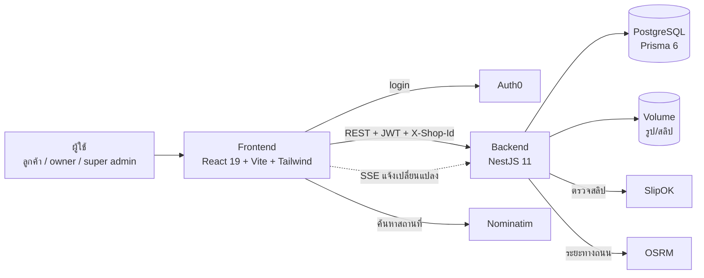
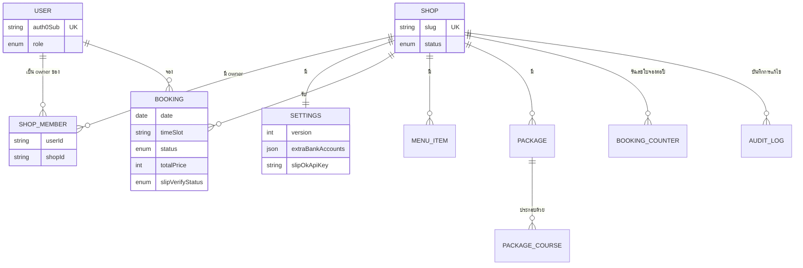
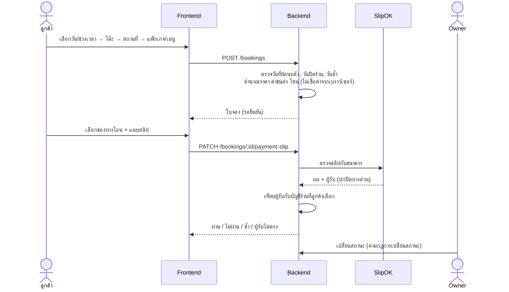
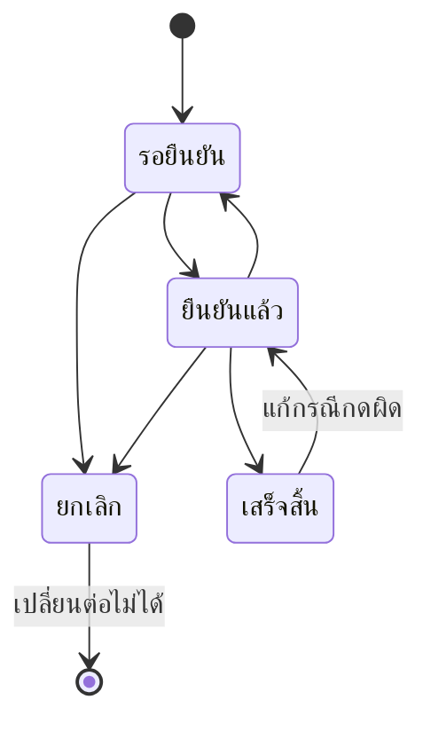

# ภาพรวมระบบ: จุดเด่นทางเทคนิค การทดสอบ และข้อจำกัด

เอกสารนี้สรุปสิ่งที่ระบบทำได้จริง วิธีที่ออกแบบ ผลการทดสอบ และข้อจำกัดที่รู้ตัว (ดูวิธีติดตั้ง/deploy ที่ [README.md](../README.md))

## 1. สถาปัตยกรรม

- Frontend และ backend deploy แยกกัน (Backend บน Railway) สื่อสารผ่าน REST + JWT จาก Auth0
- Backend เป็นตัวตัดสินกฎธุรกิจทั้งหมด หน้าจอแค่แสดงผลและตรวจเบื้องต้นให้ผู้ใช้เห็นเร็ว

## 2. โครงสร้างข้อมูล (ER)

จุดสำคัญ: ทุกตารางข้อมูลธุรกิจผูก `shopId` และลบตามร้านด้วย cascade ส่วนบทบาท owner เก็บที่ `ShopMember` (บัญชีเดียวเป็น owner ได้หลายร้าน) ไม่ใช่ที่ตัวผู้ใช้

## 3. ลำดับการจองและตรวจสลิป

## 4. สถานะใบจอง (บังคับที่ backend)

กฎอยู่ที่ [booking-rules.ts](../backend/src/bookings/booking-rules.ts) และมีสำเนาฝั่งหน้าจอ [bookingStatus.ts](../Catering%20Booking%20Web%20Application/src/bookingStatus.ts) เพื่อปิดปุ่มที่ทำไม่ได้ ตัวตัดสินจริงคือ backend

## 5. จุดเด่นทางเทคนิค

| หัวข้อ | สิ่งที่ทำ | ที่อยู่ในโค้ด |
|---|---|---|
| ระบบหลายร้าน (multi-tenant) | บทบาทตามร้านจาก header `X-Shop-Id` ตรวจกับ `ShopMember` ใน DB ทุกครั้ง ส่ง header ปลอมไม่ได้สิทธิ์เพิ่ม | `backend/src/auth/shop-context.ts` |
| กฎธุรกิจฝั่งเซิร์ฟเวอร์ | ราคา ค่าขนส่ง โซน ระยะทาง (OSRM) วันย้อนหลัง และการเปลี่ยนสถานะ ไม่เชื่อค่าจากลูกค้า | `bookings.service.ts`, `booking-rules.ts`, `geo.util.ts` |
| แก้ไขพร้อมกัน | หน้าตั้งค่าใช้ optimistic locking (`version`) ชนกันตอบ 409 และหน้าจอโหลดค่าล่าสุดให้ | `settings.service.ts` |
| กันจองซ้อน | จองในทรานแซกชัน เลขใบจองรันต่อร้านต่อปีด้วย `BookingCounter` | `bookings.service.ts` |
| ตรวจสลิปอัตโนมัติ | ยืนยันกับธนาคารผ่าน SlipOK แล้วเทียบผู้รับกับบัญชีร้านรายช่องทาง (หลายบัญชี + พร้อมเพย์) สลิปที่ผ่านแล้วเปลี่ยนไม่ได้ | `slip-verify/` |
| ความลับของร้าน | SlipOK API key เข้ารหัส AES-256-GCM ใน DB (เมื่อตั้ง `SETTINGS_ENCRYPTION_KEY`) และไม่เก็บค่าจริงใน audit log | `settings/secret-box.ts` |
| สิทธิ์ข้อมูลการเงิน | ลูกค้าเห็นข้อมูลชำระเงินเฉพาะร้านที่เชื่อม SlipOK แล้ว และไม่เห็นค่าแรง/ข้อมูลต้นทุน | `settings.service.ts` (`toClient`) |
| ตรวจสอบข้อมูลที่กรอก | Validation สองชั้น: หน้าจอตัดอักขระต้องห้ามตอนพิมพ์ (UX) + backend ตรวจซ้ำด้วย DTO (`class-validator`) และทำความสะอาดข้อมูล (`class-transformer`) — เบอร์โทร, ชื่อ (ตัวอักษรล้วน), Line ID, เลขบัญชี (ตัวเลขล้วน), เพดานตัวเลข, ความยาวข้อความ, วันที่มีจริง | `src/inputRules.ts`, `backend/src/common/input-rules.ts` |
| ความปลอดภัย HTTP | helmet, rate limit, `trust proxy`, ตรวจตัวแปรสภาพแวดล้อมตอนเริ่ม, token ทาง query รับเฉพาะ `/realtime` | `main.ts`, `jwt.strategy.ts`, `config/` |
| ความน่าเชื่อถือ | `/health` และ `/health/ready` (ตรวจ DB), graceful shutdown, แคชเส้นทาง OSRM ลดภาระบริการสาธารณะ | `health/`, `geo.util.ts` |
| ประสบการณ์ผู้ใช้ | อัปเดตแบบ realtime ผ่าน SSE, เก็บแบบร่างการจองข้ามการรีเฟรช, แจ้งเมื่อราคาเปลี่ยน, ErrorBoundary กันหน้าขาว | `useBookingsStream.ts`, `bookingDraft.ts` |
| ตรวจสอบย้อนหลัง | บันทึกประวัติการแก้ไขทุกอย่างของร้าน (ใคร แก้อะไร เมื่อไร ก่อน/หลัง) | `audit/` |

## 6. การทดสอบ

| ชุดทดสอบ | จำนวน | ครอบคลุม |
|---|---|---|
| Backend (Jest) | 246 test, 20 ไฟล์ | กฎการจอง (วันย้อนหลัง/วันซ้ำ/ปิดร้าน), การเปลี่ยนสถานะ, สิทธิ์ตามร้าน, การตรวจสลิปและเทียบผู้รับ, ตั้งค่า (409/SlipOK/เข้ารหัส), ลบร้านพร้อมลบไฟล์, DTO validation, health, ตัวแปรสภาพแวดล้อม |
| Frontend (Vitest) | 133 test, 12 ไฟล์ | การคำนวณราคา/ค่าขนส่ง/โซน, ตารางว่าง, แบบร่างการจอง, ช่องทางชำระเงิน, กฎสถานะ, จังหวัด, แคชค้นหา, ประวัติการแก้ไข |
| ตรวจชนิดและโค้ด | tsc + ESLint ทั้งสองฝั่ง | ไม่มี error |

รันด้วย `pnpm test` และ `pnpm lint` ในแต่ละโฟลเดอร์ ผลที่ตรวจล่าสุด ณ วันที่เขียนเอกสารนี้ ทดสอบผ่านทั้งหมด

## 7. ข้อจำกัดที่รู้ตัว

- **ยังไม่มี e2e test ของหน้าจอ** และการตรวจสลิปกับ SlipOK ยังไม่เคยทดสอบครบวงจรกับสลิปจริงหลายธนาคาร (test ใช้การจำลองคำตอบ)
- **รูปและสลิปเก็บบนดิสก์ของ backend (Volume)** จึงรัน backend ได้ตัวเดียว ถ้าจะขยายควรย้ายไป object storage
- **ยังไม่ได้ตั้งสำรองฐานข้อมูลอัตโนมัติ**
- **จองได้หนึ่งงานต่อวัน** (ตั้งใจให้เป็นกติกาของร้านโต๊ะจีน) ช่วงเวลาเป็นแค่ข้อมูลเวลางาน
- **ลูกค้ายกเลิกใบจองเองไม่ได้** ต้องให้ owner ยกเลิก (ยังไม่ได้กำหนดนโยบายคืนมัดจำ)
- **ยังไม่มีระบบแจ้งเตือนนอกแอป** (LINE/อีเมล) และกลไกตามกฎหมายคุ้มครองข้อมูลส่วนบุคคล (PDPA) ทำบางส่วน: มีหน้านโยบายความเป็นส่วนตัว/เงื่อนไขการใช้งานและช่องติ๊กยอมรับตอนกรอกข้อมูลครั้งแรก แต่ไม่มีการลบข้อมูลอัตโนมัติ (ลบตามคำขอเท่านั้น) และยังไม่มีปุ่มให้ลูกค้าขอลบข้อมูลเองในระบบ
- **ยังไม่มีระบบเก็บเงินจากร้าน** (ไม่มี billing/แพ็กเกจสมาชิก)
- **พึ่งบริการภายนอก:** Auth0 (จำกัดจำนวน tenant ตาม plan), SlipOK (ร้านต้องมีบัญชีเอง), OSRM/Nominatim สาธารณะ (มีข้อจำกัดการใช้งาน แก้บางส่วนด้วยแคช)
- **ช่องโหว่ dependency เหลือ 1 รายการ** (`deepmerge-ts` ในเครื่องมือ Prisma CLI ยังไม่มีเวอร์ชันแก้ ไม่อยู่ในเส้นทางที่ผู้ใช้เรียก)
- **โค้ดบางส่วนซ้ำกันระหว่าง frontend/backend** (กฎสถานะ ค่าเริ่มต้น) มี test เคสเดียวกันทั้งสองฝั่งกันไม่ให้ไม่ตรงกัน และไฟล์ `Settings.tsx` ยังยาวมาก (~1,860 บรรทัด)

## 8. แนวทางพัฒนาต่อ

1. ทดสอบ SlipOK กับสลิปจริง และเขียน e2e test เส้นทางหลัก (จอง → แนบสลิป → owner ยืนยัน)
2. ตั้งสำรองฐานข้อมูลและย้ายรูป/สลิปไป object storage เพื่อขยายเป็นหลาย instance
3. กำหนดนโยบายยกเลิก/คืนมัดจำ และ PDPA
4. แจ้งเตือนผ่าน LINE และให้ร้านเลือกรับหลายงานต่อวันได้
5. ระบบสมาชิกของร้าน (billing) ถ้าจะนำไปให้บริการจริง
